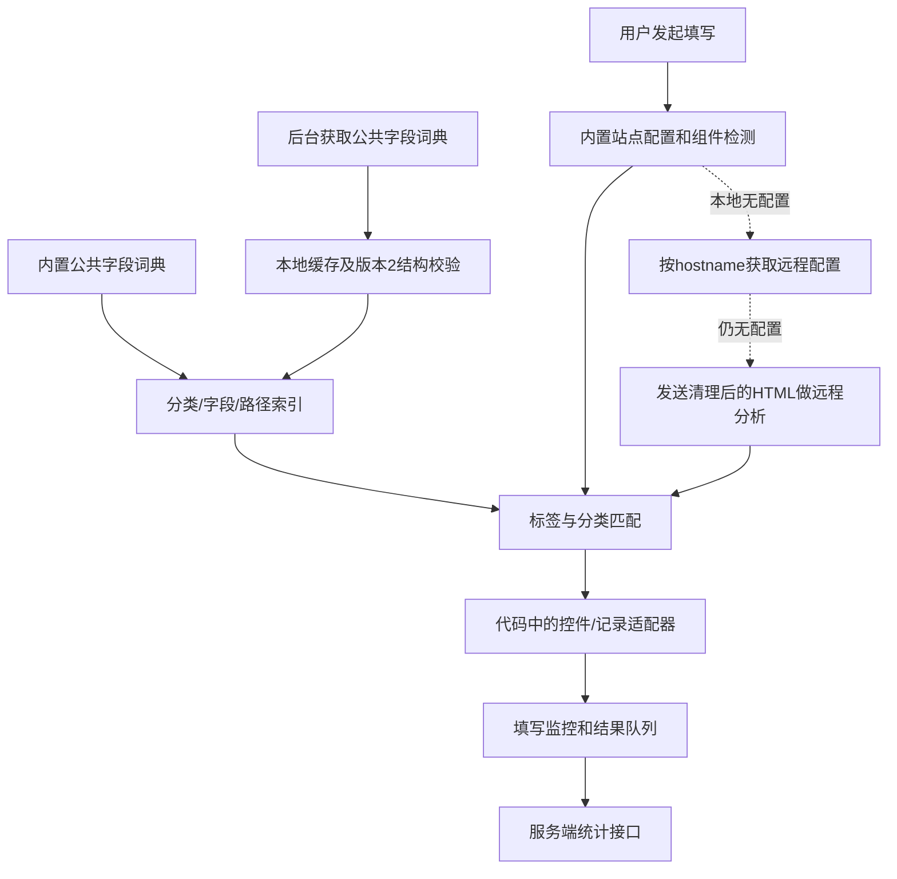

# OfferLink v1.10.7 与 LocalApply：技术对照与分步实施方案

分析日期：2026-10-29。LocalApply 源码基线：`056121c`，数据库保持 Schema v5。本轮仅静态核验和规划，不实施后续重构。

## 1. 材料、方法与结论边界

已确认可读取的真实路径：

- 发布目录：[D:/OfferLink/1.10.7_0](</D:/OfferLink/1.10.7_0>)。任务示例中的 `D:/OfferLink/1.10.7/` 不存在，已通过其父目录找到实际版本目录。
- 已有报告：[OfferLink_静态技术分析.md](</D:/OfferLink/OfferLink_静态技术分析.md>)。本文件把它作为待核验线索，没有直接将其结论当作源码事实。
- LocalApply 的 `AGENTS.md`、开发计划 v2.0、进度 v2.50、阶段三/五/六、存储专项及分层01～11步验收记录；下文以当前实现为准，旧重构方案中的初始缺口不视为仍未完成。

仅读取 manifest、业务方法、消息入口、数据流和字面量；字段规模通过静态解析 JSON 字面量统计，未执行 OfferLink JavaScript。没有安装或运行扩展，没有访问其服务器，没有复制其代码、词典、资源或凭据到项目。未访问用户浏览器资料。

材料摘要，用于以后复核偏移是否仍适用：

| 文件 | SHA-256 |
|---|---|
| OfferLink `manifest.json` | `39a6b13793a7868ea850ec1b58fb14678b81ad56d556efb2e371007cc2a3d209` |
| OfferLink `content.js` | `2f1c5a1c50d6797e29c988b79515dd66ffe19b8226c99962b0eb3047d64db1b9` |
| OfferLink `background.js` | `c2ea0faa00407f815f7f9fd7c0b80d522f43c4998ac4b8f96ac91932fe241ee1` |

证据等级：**确认**指客户端代码存在且可追踪调用/数据流；**设计推断**明确使用“建议/可能”，不是已实现行为；**无法确认**包括服务器模型、训练、规则审核、真实接口响应和线上准确率。没有服务端源码，也没有进行动态抓包。

## 2. OfferLink 实际架构

它是规则、组件适配、远程配置和远程分析混合的扩展，不是每个字段都由 AI 操作。

图中“统计上传 → 自动生成新规则”没有连线：客户端不能证明这条服务端因果关系。某些专用平台另走站点模板 API，不是所有网页统一调用一次模板接口。

### 2.1 发布结构与 iframe

`manifest.json` 确认版本为1.10.7、MV3，后台模块为 `background.js`。普通 `content.js` 匹配全部 URL，但未声明 all_frames；`auth-frame.js` 单独声明全部 frame，属于身份表单功能。`frame-autofill.js` 仅匹配中信银行两个简历编辑地址并允许子 frame。`panel.js` 是可由内容脚本页面使用的资源。

主填写路径遇到 `frameAutofill` 配置且自身位于顶层时，发送 `runFrameAutofill`。子脚本的 `frameAutofillExecute` 检查顶层与 frame 同源、路径位于 allowedPaths，再进入其配置/执行器。这不是对任意跨域 iframe 的通用授权。身份表单还包含单独开关与请求校验；LocalApply 不应据此增加登录、验证码填写。

### 2.2 字段识别和优先级

**静态词典统计确认**：21个分类、297个字段 key、1,154个字段别名条目、167个分类标签条目。计数包含重复/格式变体，不代表独立语义数或准确率。

- 公共词典形状是分类下的 labels 与 fields。`j()` 建 categoryIndex、各分类 fieldIndex 和 pathIndex。
- `T()` 校验远端词典后，清除旧词典的分类并替换为新对象内容、重建索引；不是简单把远端别名追加到所有内置字段。部分静态分类/字段 fallback 仍存在，因此也不能说远端完全替代了全部硬编码策略。
- 内容脚本初始化请求 `getFieldMappings`；后台更新后，通过 `chrome.storage.onChanged` 再应用词典。数据更换时有本地更新计数，避免初次请求的晚到响应覆盖新状态。
- `findFieldByCategory()` 优先使用 `siteMappings.fields`，再按 `siteMappings.labels` 改写标签、查询分类内精确字段；`exactLabels` 可阻止该标签继续模糊回退，否则才进入分类内模糊匹配。
- 分类识别也优先站点配置的 categories/titles，再查询公共分类词典，最后尝试模糊分类。`findFieldInfo()` 的一般路径是精确字段索引，再模糊字段，再从当前简历的 category.field 路径取值。
- 文本预处理包含大小写、标点、空白、必填等处理；相似度由包含关系及 Levenshtein 距离计算。字段和分类的局部阈值均为0.55。这是确定性字符串匹配，不是 AI 学习。
- 索引中的重复别名可能由后写键覆盖；所审查的模糊方法以严格更大分数更新最佳项，并列分数没有统一的“返回歧义”分支。站点专用规则可以另有保护，不能将该行为推广为全部平台都错误猜选。
- 部分枚举评分支路 `findBestSimilarityMatch()` 在零分或低分时会返回首个选项；另有按候选排序比例转换的逻辑。它们是局部策略，不适合 LocalApply 的可靠填写边界。

**可以借鉴**：丰富、分组且可维护的公共语义，以及站点规则与通用语义分离。**不照搬**：词典内容、0.55自动执行阈值、首项回退、排序比例猜选。

### 2.3 字段规则缓存与站点模板

| 项目 | 源码确认行为 | 不能据此推断 |
|---|---|---|
| 字段请求 | 后台 GET `/field-mappings?mappingVersion=2`，带扩展标识/版本，30秒请求超时 | mappingVersion=2不是每次规则内容发布的版本号 |
| 持久键 | `fieldMappingsV2`、`fieldMappingsV2LastUpdate`、`fieldMappingsV2ApiBaseUrl`、`fieldMappingsV2NextRefreshAt`、`fieldMappingsV2RetryApiBaseUrl` | LastUpdate不是服务端规则修改时间 |
| 新鲜度 | `Lt=300000`，最后成功更新后5分钟内直接复用 | 不是已证实的每5分钟固定轮询字段 API |
| 请求合并 | 每个 API base 的 scope 持有 pending，同一 scope 共用刷新请求 | 不代表不同来源可混用词典 |
| 过期读取 | 已有数据时普通 get 可立即返回旧数据，同时刷新；无数据或等待新鲜数据时等待刷新 | 不保证过期词典一定不可用 |
| 失败 | 保留旧 data；设置约5分钟 retry；没有旧 data 时返回空，内容脚本可继续保留内置词典 | 不是失败后立刻重试、也不是清空全部规则 |
| 强制刷新 | `refreshFieldMappings` 消息、安装/更新入口触发 force；force 可越过新鲜度和退避，仍复用 pending | 本次未在该后台文件发现 onStartup 入口，不补写成已确认能力 |
| 来源隔离 | 内存 scopes 按 API base 分区，持久 data 与 api 键成对校验 | 持久层只保存最后写入的一套组合，不等于永久保存所有来源的多份规则 |
| 结构校验 | 字典不空、分类≤100、字段总数≤1000、每个标签/别名数组≤200、字符串≤1000字符 | 不等于完整语义冲突审计、来源真实性认证或签名验证 |

站点模板另有 `getSiteTemplateMapping()`：先查当前内容脚本上下文的 Map，24小时到期删除，再经服务可达检查获取 `/site-template-mappings/{site}`；检查 name、hostname、section/row selectors、sections 等结构后写回 Map；失败返回空。缓存键是 site，所见路径没有字段词典那样的 API base 分区，也不是 chrome.storage 的24小时持久规则库。

### 2.4 AI/远程分析介入

普通招聘填写入口 `startAutoFill → bp()` 先检查账号/会员或次数、页面资格和已有简历，然后获取网站配置。它不等于“已知字段使用本地规则，所以整个产品完全离线”。

配置链路中，本地 `getConfigForUrl()` 和组件检测均未提供配置时，才进入远程 `getConfig()`：先 GET `/resume/{hostname}`；没有得到配置时调用 `cleanHtml()`，再 POST `/analyze-resume`，请求体包含 html 与 hostname。后续 `np()` 把响应消费为 simple/structured 配置，使用其标签、标题、容器、添加/编辑按钮和单选相关类选择信息，并限制到该 hostname。

这里的 `/analyze-resume` 是**网页表单结构分析**路径，不能仅凭接口名将其称为“解析用户 PDF 简历”。客户端另有 `/parse-resume` 等简历处理入口。界面显示“AI分析中”也不能证明服务端一定调用某个大模型、使用何种提示词、是否缓存/训练或是否人工参与。

`cleanHtml()` 会克隆 DOM、删除隐藏元素及脚本/iframe/图片等，但对非空 input/textarea/select，将值替换成文本节点。因而这条分析数据流**可能包含已有个人值**，不能把清理 HTML 等同于脱敏。静态发现不等于已经观察到某个用户的线上数据上传。

LocalApply 应保留用户主动选择未知字段、预览接收方及必要元数据、严格建议 Schema 的方式；不得引入 HTML 分析上传，也不得允许模型返回可执行选择器或网页脚本。

### 2.5 控件、记录与成功判断

发布包包含统一填写入口及大量组件分支：普通输入事件、原生选择、单选/复选、iView、Element/Ant Design、Phoenix、UD、搜索下拉、日期/年月、地区级联、日期范围和重复记录等。

- `fillFormElement()/fillWithRecord()` 接收当前记录，再分派站点/组件策略；不是模型生成 JavaScript 后统一执行。
- `fillInputAndTriggerEvents()` 的一个实现使用原生 setter、input/change 和 Enter；一些日期支路直接写值和派发事件即返回成功。此类局部 true 不能单独证明所有组件都经过完整延迟验证；也不能据此说整个产品没有任何专用回读。
- 搜索/级联使用专门定位、候选等待及选择逻辑；`handleSelect()` 可依据 iView、Phoenix、UD、MTD 等结构选择不同实现。
- `fillDateRange()` 在顺序填写开始与结束之间等待；`addExperienceGroup()` 有记录数据检查、唯一添加按钮检查和新增记录观察。可借鉴整条记录与单项控件分工，不应复制其实现。
- 找到 `feishu-form` 的显式配置，路径限定于飞书多维表格分享表单；这不足以证明“飞书招聘全部适配”。不能凭包中有没有某个平台品牌字符串，就确认/否认所有北森、Moka 版本支持。
- 监控器记录 seen/matched/valued/outcome/snapshot 等状态。统计请求可使用显式 success；未给出时，还有依据填写数量判断成功的 fallback。统计“成功”不等于用户投递成功或每个字段经过可靠验证。

### 2.6 学习、反馈与隐私数据流

| 行为 | 证据 | 结论 |
|---|---|---|
| 下载公共词典 | 上述字段 API 与缓存/索引 | 已确认，属于公共元数据更新 |
| 获取站点配置/模板 | hostname 配置、模板 API、远程 HTML 分析与配置消费 | 已确认客户端链路，服务端生成方式未知 |
| 上报填写结果 | `sendFillResultStatistics()` 把结果加入 `fill_result_queue`，后台 `processFillResultQueue` 上传 `/statistics/fill-result` | 已确认发送路径，不等于自动学习 |
| 队列内容 | URL、填写数量、耗时、成功标记、错误信息、`field_monitoring` 等；队列最多200条 | 可能携带网站完整路径/查询参数，LocalApply 不照搬 |
| 失败字段 | `valued()` 将期望值规范空白并截断至200字符；snapshot 的 issues 最多30条，含 expectedValue 等 | 失败诊断可能带实际简历内容，不只是错误码 |
| 后台过滤 | 上传前排除顶层 auth_token/retry_count/last_retry_at；所见路径没有删除嵌套 issues 的 expectedValue | 可确认潜在发送通路，不能当作已完成线上抓包 |
| 重试 | 普通批次最多20条、重试达到3次停止；有约2分钟队列处理定时器；无 token 时有清队列分支 | 这是统计重试策略，不是字段规则5分钟新鲜度 |
| 用户改值后自动保存私有映射 | 已审查链路未建立“单项更正→私有持久规则→下次独立验证”的完整证据 | 不声称已证实该能力，也不反向断言产品其他部分或服务器绝无此能力 |
| 服务端自动造规则/训练/发布 | 只有请求与消费代码，没有服务端实现 | 无法确认反馈是否训练模型、是否人工审核、是否即时影响公共规则 |

LocalApply 的本地诊断白名单与验证后确认记忆应保留；不新增对应上传接口或结果上报队列。

### 2.7 OfferLink 关键定位索引

以下为 UTF-8 解码后的**零起始字符偏移**，不是字节偏移；发布代码压缩为长行，不能依赖第1行定位。同名短函数可能分属不同打包模块，必须同时使用文件和偏移。

| 位置/函数或标记 | 文件 | 字符偏移附近 |
|---|---|---:|
| 内置 JSON.parse 字典 | [content.js](</D:/OfferLink/1.10.7_0/content.js>) | 98,262 |
| 公共字典校验/缓存键 | content.js | 114,100～115,000 |
| getConfigForUrl | content.js | 732,746 |
| fillInputAndTriggerEvents | content.js | 881,726 |
| getFieldMappings、j 索引、T 替换、storage 监听 | content.js | 1,110,842～1,113,900 |
| valued / snapshot / expectedValue | content.js | 1,229,400～1,231,650 |
| fillFormElement / fillWithRecord | content.js | 1,453,448 |
| handleSelect 与组件分派 | content.js | 1,531,837 |
| findBestSimilarityMatch | content.js | 1,793,000附近 |
| addExperienceGroup | content.js | 2,278,983 |
| feishu-form 的限定路径 | content.js | 3,057,368 |
| 阈值、Levenshtein、分类/字段模糊方法 | content.js | 3,335,591～3,345,840 |
| getSiteTemplateMapping / getCachedTemplate | content.js | 3,876,318～3,878,000 |
| fillDateRange | content.js | 4,102,743 |
| sendFillResultStatistics / fill_result_queue | content.js | 4,203,127～4,204,650 |
| cleanHtml | content.js | 4,291,397 |
| getConfigByHostname / analyzeHtmlForConfig / getConfig | content.js | 4,301,400～4,304,000 |
| 本地配置失败进入远程分析、np 消费响应 | content.js | 4,477,020～4,479,000 |
| startAutoFill 消息、主 bp、frame 分派 | content.js | 4,481,273；4,492,709；4,496,340 |
| Lt=3e5、Pt 缓存键、qt 校验 | [background.js](</D:/OfferLink/1.10.7_0/background.js>) | 93,460附近 |
| hr.scope/get/refresh、force/get 包装 | background.js | 131,200～134,900 |
| 字段 API | background.js | 132,145 |
| Ht 顶层上传排除键 | background.js | 103,586 |
| 填写统计上传队列 xr/kr | background.js | 137,450～139,470 |
| 规则刷新/读取、处理队列消息 | background.js | 148,500～149,900 |
| 定时队列处理、onInstalled 强制规则刷新 | background.js | 151,000～151,450 |
| frameAutofillExecute 同源和路径检查 | [frame-autofill.js](</D:/OfferLink/1.10.7_0/frame-autofill.js>) | 4,201,171 |

## 3. LocalApply 当前实现：已经具备什么

当前主链路为：可信卡片点击 → 后台授权扫描 → FieldMatchingEngine/RecordCoordinator → 后台从唯一 repository 创建 FillIntent → 内容脚本准备私有 FillPlan → 固定 AdapterRegistry 执行 → 统一回读 → 返回终态 → 用户确认后记忆。AI 只接入建议侧。

| 当前文件及定位 | 已实现，不重复开发 | 仍需注意 |
|---|---|---|
| [field-matching.js](</D:/python project/localapply-ai/data/field-matching.js:39>)：semanticDescriptor/controlDescriptor、memory:78、definitionFor:135、match:160 | 语义/控件运行时分离；精确历史映射优先；标准定义、别名及学历/经历来源筛选 | 旧 features/semanticId 仍包含 type/layout/index，必须冻结；definitionFor 不是通用模糊语义模型 |
| [mapping-compat.js](</D:/python project/localapply-ai/data/mapping-compat.js:13>)：indexFor/find | 第09步已做同 origin/profile 的跨控件兼容查询、完整语义比对、冲突/禁用保护、当前记录绑定 | 不跨 origin 自动搬运私有规则；标签/分组同义但字面不同不一定命中兼容索引 |
| [field-learning.js](</D:/python project/localapply-ai/data/field-learning.js:189>)：prepareAI:232、recognize:245、commitValue:294、fill:302、remember:329 | 页面/档案/revision、预览确认、AI取消、整条记录编排、当前控件独立验证后确认记忆；规则修改/禁用/删除/撤销 | 临时候选与已验证记忆不同；不能把 confirmed 的语义来源复用当作本次控件 success |
| [field-suggestions.js](</D:/python project/localapply-ai/data/field-suggestions.js:27>)：validate/messages | JSON Schema 白名单；只接受本次字段/已有来源引用；禁止 value、脚本、XPath/选择器和执行动作 | AI看到的是脱敏元数据及有值标记，不会替用户生成无来源答案；redact 也不等于任意自由文本绝对匿名 |
| [local-store.js](</D:/python project/localapply-ai/data/local-store.js:70>)：definition、validate、mergePublicFields:1026、publishDefinition:1044、exportPublicFields:1124 | Schema v5、定义/值/条目/映射分离；快照缓存、队列/revision/恢复点；公共定义白名单、独立审核发布、逐字段版本合并、公共导出 | 已有基础包 kind/version 和定义 version，不是从零做公共包；没有完整包级来源、差异审计、回滚生命周期 |
| [fill-contract.js](</D:/python project/localapply-ai/data/fill-contract.js:46>)：validateIntent/createIntent/validatePlan | 后台可信来源意图、一次性页面私有计划、固定能力/操作白名单 | 不允许 UI/AI提供计划；新增语义策略须同时考虑准备与验证契约，不能随意加属性 |
| [field-scanner.js](</D:/python project/localapply-ai/content/field-scanner.js:65>)：controls、scan、completion:153、recordStructures:169 | DOM/ARIA扫描；原生角色优先、嵌套去重、隐藏步骤排除、日期电话地址分组；Moka及明确语义重复模块 | 没有通用跨域iframe扫描；通用重复获奖/证书/论文仍降级；元数据完成/占用标记不包含网页值 |
| [field-adapters.js](</D:/python project/localapply-ai/content/field-adapters.js:91>)：optionEqual、groups、plan、fill/accepted | Moka Sugar、复合日期/电话/地址、日期精度转换及局部选项证据 | 工作经验等少量业务语义仍处在控件层；不能说 ValueResolver 已完全独立 |
| [registry.js](</D:/python project/localapply-ai/content/controls/registry.js:16>) 及 controls 子模块 | 已注册 text/textarea/contenteditable/select/radio/checkbox/date/phone/dropdown/address；多重命中拒绝；原生单/多选、搜索下拉和级联流程 | 自定义多选与未知封闭组件不是全部支持；不需要重新建注册表 |
| [verified-fill.js](</D:/python project/localapply-ai/content/verified-fill.js:84>)：prepare/validatePrepared/fill | 节点/候选/来源快照、非空保护、适配器执行与验证统一终态；旧路径保留兼容 | 主消息路径走后台意图，不能拿仍保留的旧兼容方法说明新链路未分层 |
| [verification.js](</D:/python project/localapply-ai/content/controls/verification.js:5>) | 120/240/500ms观察、至少最后两次接受；区分回退、校验失败、取消、失效 | 不证明500ms以后或服务端保存成功；不读取框架私有对象 |
| [sidepanel/field-learning.js](</D:/python project/localapply-ai/sidepanel/field-learning.js:244>)：scanPage、AI预览、fillSelected、showRules | 点击直填、未知字段选择与AI发送预览、字段差异确认、单项/批量、规则维护；卡片复用，不只旧侧栏 | 卡片导航/日志/小球是已交付内容，与词典或控件能力不应混算 |

此外，[options/data-management.js](</D:/python project/localapply-ai/options/data-management.js:80>) 已有公共字段导入/导出 UI：限制1MiB、显示数量并确认、调用后台 mergePublicFields；目前不是逐字段语义差异预览。后台对定义的 label/aliases/description 做结构约束，但白名单不能保证这些字符串里没有个人文字，独立审核仍必要。

预置 PROFILE_TEMPLATE 实际统计为155项、12个资料分类、278个 patterns 条目；FIELD_INDEX 有182个键。patterns 含正则和重复，且不等于当前用户数据库的别名数量，不能直接与 OfferLink 的1,154条作准确率比较。私有动态字段和用户删除的字段也不在这个静态规模结论中。

历史测试证据：进度 v2.50 记录基础314/314、完整浏览器384通过/1个Responses提示超时（共385项），后续阶段六/Responses定向15/15通过。本轮没有重跑这些测试，也没有把历史批次重叠相加。北森登录受限、真实Moka生日问题暂停、飞书待测，仍不是全面平台验收完成。

## 4. 十项差距对照

| 维度 | OfferLink可确认机制 | LocalApply真实对应与具体差距 |
|---|---|---|
| 字段识别准确性 | 较大词典、分类上下文、站点覆盖和0.55模糊评分 | templates.normalizeLabel/matchLabel 与 definitionFor 已有；缺词典覆盖/冲突的系统审计和真实ATS语料。exact多命中后仍可能进入fallback，不能笼统声称所有别名歧义都被阻断。静态分析无法评判两者实际准确率高低 |
| 已知字段免AI | 大量本地确定性路径，但主入口还涉及账号/配额/远端配置 | match→createIntent→Registry 已可无Key、无AI使用；应增强数据覆盖，不重建离线填写器，也不引入会员服务依赖 |
| 未知字段AI理解 | 未知站点远程分析HTML后返回页面结构配置，模型实现未知 | prepareAI/FieldSuggestions 已实现严格元数据建议和确认。差距在候选目录选择、解释与预算；catalog 当前 slice(0,200)，不是没有AI能力。不应改为上传HTML |
| 跨网站、跨控件复用 | category.field提供通用语义来源，站点配置补映射 | mapping-compat已支持同站跨控件；标准字段也可跨站本地匹配。私有规则不跨站自动用；同义标签不一致的兼容、受控跨站建议仍可增强，不能复制旧验证状态 |
| 选项语义转换 | 组件/业务转换丰富，部分评分与首项回退偏宽 | native.resolve已实现实际标签到编码如男→M，以及原生多选；optionEqual有少量明确等价。欠缺按fieldId统一、可解释、可复验的枚举语义服务，不是完全没有选项解析 |
| 自定义控件 | 丰富的组件和站点专用分支 | 固定Registry、下拉三阶段、日期电话地址桥接已有；欠更多经实站证实的薄适配、自定义多选、框架弹层生命周期用例。复制大量平台判断不能代替测试 |
| 动态经历 | 有专用组查找、数据配对和唯一添加检查 | RecordCoordinator及阶段六明确语义分组已实现；通用获奖/证书/论文与未知站点记录结构仍降级。来源按本会话整条绑定，不能退回逐字段按序猜 |
| 填写成功验证 | 有监控与专用分支，但部分返回true是写入/事件完成；统计阈值不是通用回读证明 | LocalApply统一验证更明确；真实Moka仍有误报未解决，有限窗口不能当成所有框架内部状态/服务端接受证明。优先按新诊断复现修复，不能关闭保护 |
| 历史规则维护/更新 | 远程公共词典、模板缓存与统计上传 | 用户映射CRUD/撤销、cache失效、版本化公共字段合并均已有；缺包级来源、逐项差异、兼容性和公共包回滚。不要把公网词典当用户映射、不要重做mergePublicFields |
| 本地缓存和隐私 | 后台按来源缓存公共词典；HTML和统计存在值的潜在发送通路 | repository快照缓存、持久化日志与私有映射已有；阶段七公共文本审查/离线包生命周期待补。拒绝复制expectedValue遥测和远程HTML分析；无需新增后台上传服务 |

## 5. 建议改进：文件、风险及验收要求

以下全部是**下一轮起需独立授权的设计**，本轮未实现。保留Schema v5、旧semanticId/features、个人库和既有注册表。

### OA-01｜P0：只读公共词典审计

- 文件：拟新增 `tools/audit-field-catalog.cjs`、`tests/field-catalog-audit.test.cjs`；只读引用 `data/templates.js` 与现有公共定义契约，不接入匹配/执行路径。
- 设计：统计有效字段、别名及格式化结果，报告同分类冲突、跨分类歧义、空/重复别名、规范化碰撞、失效目标。区分“明确上下文可消歧”和“缺上下文应手选”；把有意别名复用记录为待审核，而不是强行合并字段。只分析仓库公开元数据，不读取用户storage或OfferLink词典。
- 风险：把多分类合法复用误报为故障，或把正则字符串当普通别名执行。首版正则仅标记审查，不执行来自包的任意表达式；不修改现有行为。
- 测试：同义项、同名异义、学校/专业跨模块、第一/最高学历、规范化碰撞、恶意字符串、稳定排序、零网络/零写库；产物不得含个人值或凭据。

### OA-02｜P0：小批量、自主整理的字段语义补齐

- 文件：`data/templates.js`、`data/field-matching.js`、`tests/field-learning.test.cjs`、相关合成页面与 `tests/browser.test.cjs`；必要时增加本项目自建的公共元数据文件，不复制第三方词典。
- 设计：依据自身失败用例和公开常用术语逐批补少量别名，记录字段ID、分类/学历角色和反例。先处理可明确证明的同义词，不降低全局阈值。对多命中fallback的具体行为补测试，是否阻断/提示单独评审，不改变旧散列算法。
- 风险：家庭姓名混入本人、第一学历混最高学历、职责跨工作/实习、别名过宽；用户已删字段被重新补回。
- 测试：正反例成对；多条同学历保留歧义；已填值、无Key与记忆优先级不变；fieldCatalog迁移标记不因别名补齐而重建已删除目录。每批扩大都须有独立证据。

### OA-03｜P1：枚举语义策略逐步统一

- 文件：拟新增 `data/value-resolver.js`；渐进接入 `content/controls/native.js`、`content/controls/dropdown.js`、`content/field-adapters.js` 与相关registry测试；涉及契约时再评审 `data/fill-contract.js`、`content/verified-fill.js`。
- 设计：从最小字段集合开始，以fieldId、已有来源和当前选项解析明确等价，返回 resolved/ambiguous/incompatible。复用现有真实候选身份与计划；让准备和回读使用同一等价证据，避免准备成功而验证仍按旧字面失败。真实来源值不能被静默改写或存回。
- 风险：学历与学位混用、经验区间靠数值猜测、枚举别名一对多、只改prepare不改verify。禁止比例猜选、首项回退、学校去校区后缀、年月补日。
- 测试：男/M已有用例保留；明确枚举同义及冲突、1年以下/1年以内/1年以上边界、重复标签/码、禁用项、React/Vue回退；失败不执行第二路径，资料与旧映射不变。

### OA-04｜P1：在现有公共包基础上增加离线版本生命周期

- 文件：`data/local-store.js`、`options/data-management.js`；拟新增 `data/rule-packages.js`、公共清单/版本文件及对应store/browser测试。后台仍持有唯一repository，文件页保持自身锁内仓库。
- 设计：先包装已有 `localapply-public-fields/version=1`，增加包级发布标识、兼容范围、来源说明和内容摘要；Schema v5版本、字段自身version、现有fieldCatalog迁移标记、包发布版本必须分开。摘要用于一致性检查，不当作来源签名。
- 初版只包含经独立审核的公共定义及别名。若将来需要公共网站语义规则，另建只含标准fieldId、明确标签/分类及受限公共站点标识的白名单契约；不混入私有mappingRules，不接受网页脚本、AI选择器或任意XPath。
- 导入先展示新增/变化/冲突及影响，绑定当前revision确认后调用已有版本合并；必须处理同版本内容不同、未知包格式、低版本和不兼容类型。默认完全离线，不增加轮询、服务器或上传。
- 回滚不能直接重导旧字段包：现有merge会跳过低字段版本。未来需独立审核的“包贡献/元数据回滚”命令；字段已有个人值、映射引用或安装后被用户修改时，禁止破坏性删除/全库恢复，提示人工处理。首版不支持删除、重命名、跨分类改义，也不承诺自动降级。
- 风险：公共包覆盖私有同ID字段，元数据文字夹带隐私，规则更新改变语义，回滚删除用户后续资料，恶意正则或过大文件。
- 测试：版本冲突、并发修改、失败原子性、缓存重建、安装前后备份往返、用户删字段保护、有值字段回滚拒绝；证明包、日志、网络中没有个人值/站点私有映射/Key。已有公共导出与合并测试继续保留。

### OA-05｜P1：优化现有AI建议的候选目录和解释

- 文件：`data/field-learning.js`、`data/field-suggestions.js`、`sidepanel/field-learning.js`、字段学习单测及Mock AI E2E。
- 设计：替换不解释的前200项截取为有预算且可说明的候选选择，优先明确分类/已有候选；未覆盖目录必须提示，允许人工选择。不扩大为上传个人值。建议呈现对应标准定义、分类、已有来源是否有值和不确定原因，仍由用户确认。
- 可选缓存仅在当前页面会话保留，键包含字段元数据、目录/资料revision及模型配置上下文；取消、导航、换档案或配置变化即失效。不是持久学习，也不自动调用AI。
- 风险：筛掉真正目标、模型引用未发送来源、私有标签里残留个人文字、缓存跨页面使用或置信度被当作执行依据。
- 测试：超过200定义且目标在后段、空来源、不同档案/模型、超时/429/恶意JSON、取消晚到、无Key仍能手选；断言请求不含网页值/完整HTML/简历，建议不能携带脚本/选择器。

### OA-06｜P1：继续真实平台薄适配及诊断闭环

- 文件：复用 `content/controls/*`、`content/field-adapters.js`、`content/field-scanner.js`、`data/fill-result.js`、`test-pages/*`、`tests/browser.test.cjs`；有必要才增加固定打包的组件文件。
- 设计：先按当前Moka具体guardCheck复现，再针对授权北森/飞书的真实结构建立合成夹具；按唯一关联菜单、受控状态和记录角色接入现有Registry。只有真正新控件类型才讨论注册表/契约扩展，不整体重写。
- 风险：把飞书普通分享表单当招聘页通用适配，放宽失效守卫来掩盖误报，以搜索词/DOM外观当成功，或让添加/日期事件触发下一步/投递。
- 测试：每站通过/失败/登录受限/待测矩阵；候选重复、异步/销毁、失焦/取消、部分值、受控回退、动态结束日期和记录替换。只更新验证证据，不上传失败值；继续验证零提交。500ms之后与服务器保存仍保留人工核查边界。

### OA-07｜P2：跨网站私有语义只提供受控建议

- 文件：`data/mapping-compat.js`、`data/field-matching.js`、`data/field-learning.js`、规则管理界面及mapping-compat测试；复用现有同站跨控件机制。
- 设计：标准公共字段跨站的本地匹配保持原样；个人历史只能在同档案给新网站候选建议，不能把其他origin规则当作本域已确认记忆。用户明确选择并在当前控件验证后才另存当前域变体；当前entryId仍由当前记录绑定。
- 风险：同名不同义、私有标签与具体网页结构泄漏、复制历史lastVerifiedAt、禁用规则被旁路。
- 测试：跨origin默认不自动命中、同标签不同分类/学历、多实例、改名/禁用/删除/撤销、当前记录绑定、用户手选优先；备份无运行时索引，日志无标签/值。

### OA-08｜P2：有实际需求后再做受限iframe或可选在线公共更新

- iframe文件：`manifest.json`、`background.js`、`data/field-learning.js`、扫描与session模块。先限授权站点的明确同源frame，分别绑定top/frame文档、URL、来源及取消；不直接all_frames全开，不扩展登录/验证码功能。测试父子互换、frame重建/导航、跨域拒绝、来源伪造及零提交。
- 在线公共更新文件：未来独立更新器与设置入口，必须另获授权；仅下载审核过的公共包，默认关闭、明确来源、兼容校验/回滚和失败旧包回退。这里借鉴缓存思路，不照搬5分钟轮询或统计上传；若需可信签名，另评审信任根、密钥轮换和吊销。
- 二者都不是本轮或下一最小任务，不创建服务端、遥测接口或GitHub提交能力。

## 6. 建议实施顺序与阶段关系

1. **OA-01只读审计**：先建立自有词典/冲突基线；同时保留阶段六真实平台未完成状态。
2. **OA-02小批语义补齐 + OA-06已授权真实问题复现**：每次围绕一类可验证失败，不一次搬入几百别名。真实Moka生日问题是否恢复处理由用户后续安排。
3. **OA-03最小枚举策略**：先一个字段，再扩大到更多控件；沿用既有意图、唯一候选和验证机制。
4. **OA-05 AI目录预算/解释**：本地确定性结果稳定后，改进剩余未知项，仍不自动调用或执行。
5. **OA-04离线包生命周期**：复用已有公共字段包，补预览、版本、兼容和受限回滚；与计划阶段七关联，但本轮不宣布进入阶段七，也不开展Git同步。
6. **OA-07跨站建议、OA-08iframe/在线下载**：有独立用例、授权和边界测试后再做。任何新增网络能力都不是前述审计或词典补齐的隐含依赖。

所有实施轮次均应保留旧回归、历史失败与许可证；不改Schema v5/旧散列、不自动stage/commit/push、不创建分支。离线包、公共词典与私人映射是三种对象，不能通过自动“学习”合并。

## 7. 下一轮可独立授权的最小任务

**仅实施 OA-01：LocalApply 公共字段词典只读审计。**

交付范围：一个本地审计脚本、一组只用合成元数据的单元测试、审计结果摘要。输入只来自本仓库公共模板/定义；输出字段数量、规范化别名碰撞、分类内冲突和跨分类需上下文的条目，不读storage、真实简历、诊断日志或OfferLink词典。不改匹配优先级/阈值、自动填充、公共定义、Schema或UI，不调用网络。

验收：同一输入结果稳定；能检出别名重复及同名多目标，合法跨分类复用单独提示，不声称仅凭字符串审计便能判定全部语义；拒绝或仅标记任意正则/恶意输入，不执行外部文本；输出没有字段值、凭据或本机个人档案。根据报告再单独选择OA-02的小范围补齐任务，不自动实施下一步。

## 8. 本轮交付与验证

本轮只新增本技术对照文档，保留现有开发进度及历史验收。没有修改业务代码、Schema、依赖、权限或测试；没有安装/运行OfferLink、调用其API、复制专有实现/词典、自动提交申请或执行Git写操作。

实际验证为：本地路径可读检查、manifest版本/入口核对、关键文件摘要、静态字面量统计、关键函数和调用点交叉定位，以及本文件路径/定位和Git差异检查。本轮不重跑完整测试，不将历史314/314或15/15声称为本轮测试结果。分析结束后停止，等待下一轮独立实施授权。
