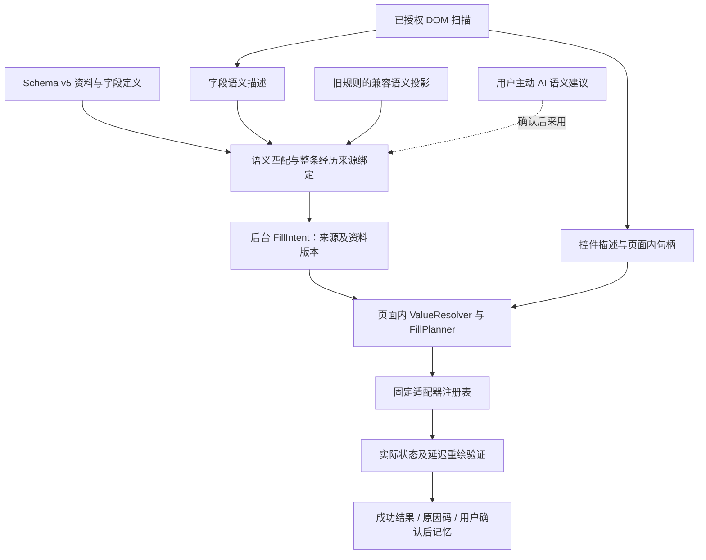

# 字段语义与自动填写引擎分层重构方案

日期：2026-10-28。状态：**架构分析完成，实施待用户确认**。

以当前工作区源码、`AGENTS.md`、`DEVELOPMENT_PLAN.md` v2.0、`DEVELOPMENT_PROGRESS.md` v2.30 及阶段五验收报告为依据。本轮不实施引擎重构，不改变 Schema v5、用户资料、权限或阶段完成状态。

## 1. 结论与当前基线

建议渐进重构。当前已经有“后台匹配 → 授权内容脚本写入 → 延迟回读 → 用户确认记忆”的链路，问题主要在职责交叉、选项解析不统一，以及语义身份和控件结构混合。应先统一通用执行体系，再扩展招聘平台。

需要保留的现有能力：

- `FieldMatchingEngine` 的本地词典、上下文与学历来源筛选。
- `FieldLearning` 的档案/页面会话、revision、确认令牌、AI 取消、单项学习及规则撤销。
- 原生 setter/事件派发、Moka 弹层归属证据、真实候选点击、日期精度与复合子项保护。
- 非空网页值保护、填写后再学习、日志白名单，以及全部阶段一至五回归。
- 简历中心、模型读取 PDF/DOCX、凭据、岗位与已投职位模块；本次不重做这些模块。

当前工作区还包含上一轮“1 年以下”空格兼容的四个未提交文件：`content/field-adapters.js`、`test-pages/moka-sugar-controls.html`、`tests/browser.test.cjs`、`tests/field-adapters.test.cjs`。本轮保留，不把它们算作架构重构成果；其新增浏览器场景尚未验证成功，不能套用此前的通过数。

历史阶段五基线是基础 172/172、完整浏览器 207/207；后续 Moka 基线为基础 192/192、相关浏览器 88/88、控件专项 23/23，批次重叠。本轮仅执行相关单元测试 **49/49，0 失败、0 跳过**，3.50 秒，没有重新执行完整回归、Playwright、真实招聘网站或付费 API。

## 2. 真实代码职责与耦合证据

以下行号对应分析时的工作区；后续实现以函数名继续定位。

| 当前模块 | 已有职责与可复用部分 | 需要调整的边界及证据 |
| --- | --- | --- |
| `data/templates.js` | 标准 ID、同义词、八个重复模块、资料中心模板 | `REFERENCE_FIELDS` 第 203 行开始使用 `select/date/region` 等编辑控件；`referenceTemplate()` 第 364 行已经部分区分 `widget` 和 `inputType`，不能认定完全没有分层。但持久化定义仍取 `inputType`，不能把它当成网页控件类型。 |
| `data/local-store.js` | Schema v5、字段定义/个人值分离、revision、完整校验、备份及迁移 | 第 12、70、90、108 行规定类型、定义和个人值校验；`select` 允许历史自定义文字。第 240～255 行严格限制映射属性，并调用当前指纹校验器。不能直接加入 `dataType/semanticKey/controlFingerprint` 持久化属性，也不能改旧散列算法。 |
| `data/field-matching.js` | 同站历史映射、定义/别名、学历筛选及来源候选 | `features()` 第 18 行包含 `type/layout/index`；`semanticId()` 第 25 行对整组散列；`memory()` 第 58 行要求指纹和完整 features 同时相同。`targetsFor()` 第 86 行又负责经历来源选择，语义匹配和来源解析仍混合。 |
| `data/field-learning.js` | 可信后台编排、确认、API 调用、本地写库、记忆管理 | `prepareRecords()` 第 111 行负责整条记录来源、动态添加与安全限制；`learning:fill` 第 282 行把原始本地值直接发给内容脚本，没有独立通用计划。`learning:remember` 第 306 行已经要求验证成功，应保留。 |
| `content/field-scanner.js` | 授权扫描、DOM/ARIA 标签、局部分组、节点 registry | 第 103～113 行将语义、控件 type、重复组 index 和可选项放在同一字段；第 123 行 `record()` 同时依赖旧语义指纹作失效检查。第 156 行的经历块识别主要针对 Moka 结构。应增加独立控件描述，不能只删除指纹中的 type。 |
| `content/field-adapters.js` | 日期/电话/地址分组、格式转换、Moka 下拉与日历、局部读取和验证 | 同时承担 detect、plan、execute、read、verify。第 76 行的 `optionEqual()` 按“工作经验”标题决定同义规则，第 86 行 `fillDropdown()` 同时打开、搜索、选项匹配和点击。业务语义进入了控件操作层。 |
| `content/filler.js` | 原生 setter、框架事件、文本/contenteditable、高亮 | 第 101、156 行还保留旧 select/radio 的别名和子串选择；第 192、211 行搜索候选时可回退 `document.body` 并取首项。第 238 行 `fillElement()` 对普通文本也调用候选搜索，不是纯文本写入原语。 |
| `content/verified-fill.js` | 非空冲突、唯一候选、延迟回读与固定诊断 | 第 47 行 `write()` 按 type 集中分支；原生选项、ARIA、Moka 使用不同选项匹配规则。第 29 行在 120/500ms 回读，第 10 行遇节点替换直接失败；第 85 行还有通过中文错误文本推导原因码。 |
| `content/detector.js` | 内容脚本可信消息路由和旧接口 | 第 434 行走 VerifiedFill；第 496 行的旧 `wsa:autofill/fillOne` 直接走 Filler。两条可执行链路的唯一性、验证和保护并未完全统一。 |

### 已实际复现的指纹问题

仅用合成字段 `{label:'性别', group:'个人信息', kind:'', degree:'', index:0}`，其他属性不变：

| 控件 | 当前 semanticId | 已确认 select 规则是否命中 |
| --- | --- | --- |
| select | `semantic.3be13eaeef07a828` | 是 |
| radio | `semantic.b545659f37a91bd5` | 否 |

这是历史映射未命中；标准字段仍可能通过词典重新匹配，并非所有字段因此无法填写。旧指纹也承担存储校验和网页失效检查，不能原地换算法。

### 主要问题的优先级

1. **P0：通用写入边界不一致。** 新链路的普通文本最终仍调用旧 Filler，第 253～258 行可能触发全页候选点击。应抽取纯文本原语，并让自定义选项只在有归属证据的候选内执行。不能以新适配器失败为由自动回退宽泛旧选择。
2. **P0：没有通用选项解析和 FillPlan。** 原生 select/radio 直接比较 value 或 label；Checkbox 组主要按网页 value 数组处理。`男 → M` 应由当前标签证明，不能由执行器猜编码。`matched` 目前只代表语义/来源匹配，不证明控件可操作。
3. **P1：语义记忆被 type/layout 绑定。** 必须拆成语义匹配依据与当次控件执行依据，同时保留旧规则的校验能力。
4. **P1：来源配对、动态记录和单项执行交错。** 应先绑定整条经历，再解析字段值和执行；记录序号不应成为跨会话稳定来源的唯一证据。
5. **P1：验证窗口及错误分类不统一。** 已有延迟回读有价值，但不能证明框架所有内部状态或未来任意重绘。应明确观察证据、超时和节点替换处理，不把全部失败归成“不支持控件”。

## 3. 推荐分层与模块边界



### 3.1 Profile / Field Schema

不改变现有定义与个人值。新增**运行时投影**，分别表达：

- `logicalType`：string、enum、number、boolean、date、string-array。
- `storageType`：当前 Schema v5 的 text、textarea、select、number、boolean、date、multiSelect。
- `editorHint`：资料中心现有 widget；与招聘网页无关。

例如 `builtin.gender` 的持久化 `type:'select'` 保留，投影为 enum；网页仍可是 text、select、radio 或自定义下拉。枚举保留旧库允许自定义文字的兼容性，不能反过来清理不在预设 options 中的旧值。历史生日可能以 text 保存，只对明确的日期原文作运行时转换；非法或歧义原文保留，不清库、不推算。

### 3.2 Page Scanner / ControlDescriptor

保留旧 `fields` 和 `semanticId` 消息形状；逐步增加独立、版本化、白名单校验的 `controlSnapshots` 封套，以 scanId 关联，避免直接往现有 `validateField()` 的对象中塞属性。

控件描述包含 controlKind、可操作状态、日期精度/约束、复合子项角色、弹层关联方式、结构版本、ControlFingerprint。节点、原始选项及其句柄仅存在内容脚本 registry；跨消息的数据只传有限脱敏结构，不含当前 value/checked、HTML 或任意选择器。

扫描本身不点击。首次识别不清楚的控件保留 unknown；用户发起填写后，适配器才可在有界范围打开菜单或输入查询以补充候选证据。原生 radio/checkbox 按真实局部组边界收集，补齐 `label[for]`、ARIA 关系，不能仅靠相同 name 合并整个表单的多条经历。

### 3.3 Matching / Record Resolver / Value Resolver

- Matching：决定网页语义对应哪个 fieldId，复用现有词典和安全上下文规则。
- Record Resolver：决定本次网页记录对应哪个 entryId；保留首条 entryId=null 的兼容槽位。同条所有字段共享配对，禁止逐字段跨记录借值。
- Value Resolver：以 fieldId 和可信来源为依据，把实际资料转换为规范意图，再与当前候选标签比较。结果区分 resolved、missing、ambiguous、incompatible。
- FillPlanner：根据当次控件和来源生成操作计划；没有唯一合法适配器或目标时不产生可执行计划。

工作经验“一年以下”“1 年以下”的有界等价、学历/政治面貌的明确同义词属于 Value Resolver 的**字段语义策略**；Moka/原生/ARIA 适配器只接收已经解析的目标，不知道这是哪个业务字段。不得用一个全局“去标点/子串相同”函数处理所有字段。

日期只降低到网页明确要求的精度，例如完整日期 → 年月；年月 → 年月日必须提示缺日。学校不能去掉校区后缀猜选；地区只拆分明确路径；经验区间不能按数值落点猜选，`1-3年` 不推断为 `2年`。

### 3.4 FillIntent 与私有 FillPlan

后台从唯一 repository 取值，先确认 profileId、fieldId、entryId、revision 和文档会话，再发送 FillIntent。UI 和 AI 都不能提供可直接执行的计划。

FillIntent 包含固定版本、来源引用、资料 revision、授权 scanId/documentId、逻辑类型及本次需要的值。实际值是允许填写当前字段的必要数据，仅在可信后台/对应页面内存中短暂存在，不进 AI 或日志。

页面内计划示例（全部为合成数据）：

```json
{
  "planVersion": 1,
  "planId": "plan.synthetic",
  "documentId": "document.synthetic",
  "scanId": "scan.synthetic",
  "source": { "fieldId": "builtin.gender", "entryId": null, "revision": 42 },
  "controlFingerprint": "control.v1.synthetic",
  "structureVersion": 7,
  "adapterId": "native-radio",
  "operation": "select-option",
  "targetOption": { "handle": "option.synthetic", "label": "男", "value": "M" },
  "verification": { "kind": "selected-option", "optionHandle": "option.synthetic" }
}
```

`M` 来自网页中标签为“男”的唯一真实候选，而不是预设代码表。实际 Plan 还在私有上下文绑定本次期望值、冲突快照和候选版本；它不能导出、持久化或送给模型。执行前重验结构/候选/会话；变了就失效并重新准备，不在过期计划里换一个“看起来相近”的节点。

### 3.5 控件注册与执行

推荐统一契约：

```js
// 根据当前控件的明确结构证据判断支持范围，不在探测阶段点击。
adapter.detect(control, context);
// 准备唯一目标和验证条件；用户已发起填写时可有界打开/搜索，但不提交选项或表单。
await adapter.prepare(control, intent, context);
// 仅执行固定计划，返回写入尝试，不据此宣布成功。
await adapter.execute(plan, context);
// 检查实际组件状态、校验及延迟重绘，返回结构化验证结果。
await adapter.verify(plan, context);
```

context 统一提供 AbortSignal、页面/结构校验、局部句柄解析、交互预算及固定诊断工具。注册表为打包代码，不允许从 API、页面或 AI 动态注册脚本；多个相互冲突的 detect 结果不能靠任意权重猜选。

第一批注册 text/textarea/contenteditable、native-select、native-radio、native-checkbox。随后桥接现有 Moka 下拉/日历、日期/电话/地址复合控件，再完善通用 ARIA 搜索下拉。已有 `A.plan/A.fill` 可以暂时桥接，不能把现有会直接点选的 `fillDropdown()` 改名为 prepare 就算完成拆分；复杂控件阶段必须把候选发现与实际选择分开。

`RepeatedRecordCoordinator` 属于批次编排，不是单字段 Adapter：先确认整条来源和空槽，必要时复用已有唯一添加入口，再重扫新增字段。保留每模块/每次最多 20 条的现有限制，不自动点下一步、删除或提交。

### 3.6 验证与状态

继续使用 matched、needs_confirmation、missing_value、filling、success、failed、unsupported。另用运行时 planState 表示 unprepared/ready/invalidated，不把“已匹配”改成“已成功”。

验证至少检查：原生值/选中项、checkbox/radio checked、自定义下拉真实选择证据、关联弹层、aria-invalid/原生 validity、失焦及有界延迟重绘。React/Vue 测试同时断言夹具组件 state 和重绘结果；产品运行时不读取框架私有 Fiber 或注入主世界代码假装通用证明。

节点替换时旧计划不能继续写。若同一授权记录中能唯一重定位相同语义和控件，可仅回读新节点；否则返回 control_replaced，刷新扫描后生成新计划。路由/文档变化直接撤销，不沿用旧来源。观察窗口有明确上限，不能承诺未来任意重绘永不回退。

新增固定原因码而不解析错误中文：unrecognized_field、missing_source、ambiguous_source、unsupported_control、option_not_found、ambiguous_option、insufficient_date_precision、existing_value_preserved、page_validation_failed、write_rejected、controlled_value_reverted、control_replaced、session_expired、cancelled、timeout。

已有日志枚举做兼容映射；新增阶段/原因需同步 `data/diagnostics.js` 白名单和测试。可记录 adapter、阶段、候选数量、耗时、结果，不能记录标签、选项文字、用户值、完整 URL、计划或 Key。写入函数返回 ok 只代表尝试完成，只有 verifier 可给 success。

## 4. SemanticKey / ControlFingerprint 与旧规则兼容

### 4.1 两种身份各司其职

| 身份 | 内容与用途 | 不应包含 |
| --- | --- | --- |
| SemanticKey v1 | 脱敏标签 + 分组 + 经历 kind + 明确学历/语义角色；确定“此字段是什么” | 控件 type、layout、选中值、DOM 节点、选项编码 |
| ControlFingerprint v1 | 当前控件类别、复合子项角色、已识别组件族、格式/约束及关联关系的结构摘要；判断计划是否仍适用 | 简历值、当前选择、完整 DOM、含个人信息的 ID/URL |

同一个 SemanticKey 可以在多条经历中重复，因此它不是网页实例 ID，也不是个人值的唯一键。仍要使用 scanId、页面内 recordId、实例出现位置和**当前会话确认的 recordId→entryId 绑定**区分来源。index 仅是旧规则兼容或局部定位证据，不能用作跨会话稳定 entryId。

两个散列都只是索引，命中后比较完整规范结构，保留当前防散列碰撞的做法。

### 4.2 推荐方案：保持 v5，内存兼容投影，不改旧散列

1. 冻结原 `features()/semanticId()/validateField()` 的旧规则行为与字节级测试；将其明确标记为 legacy 特征契约。
2. 读取 mappingRules 时，从已经验证过的 `rule.features` 派生 SemanticKey；ControlFingerprint 在每次扫描时重建。投影仅在内存按 database revision 建索引，编辑、禁用、删除、撤销、导入后立即失效重建。
3. **先查旧精确映射**；未命中才尝试语义兼容查询。无 semanticId 的最老规则仍须重新确认，不升级成已验证记忆。
4. 不向 mappingRules 写新属性，不批量改 semanticId/features，不调整用户字段和个人值。无需数据库写入迁移，现有 v5、v4/v3 兼容导入导出继续按原路径工作。
5. 当前新控件填写、验证并经用户确认记忆后，按现有规则形状保存对应的新控件变体。旧规则保留；多条变体可共享语义目标，但每条控制结构的验证证据独立，不能把旧时间戳当作新控件已经验证。

### 4.3 语义兼容命中的执行条件

- 同 origin、同 profile；标签、分组、kind、学历角色完整相同，有足够上下文。跨域不复用，缺分组等证据不足时只提供建议。
- 当页同语义候选必须有唯一实例，或已经明确绑定重复记录来源。候选多个、来源冲突、经历重排无法证明配对时 needs_confirmation。
- 所有相关规则的目标无冲突；未确认/编辑待验证的规则不能因另有旧成功规则而被悄悄忽略。禁用/删除不得通过陈旧兼容索引复活；存在禁用变体时跨类型复用保守要求重新确认，现有精确查询语义保持不变。
- 目标字段及 entryId 仍属于当前档案；重复模块必须有当前会话来源绑定，不能仅因历史 index 相同就套入旧 entryId。
- 只复用“fieldId 的语义关联”，不复用旧 adapter、DOM 定位、选项编码、已填写状态或执行验证。当前控制结构必须重新 detect、prepare、冲突校验和 verify；不支持就停止。

实现中保留 `source:'memory'` 兼容 UI 分支，并增加运行时 `memoryMatch:'exact'|'semantic'` 与本次验证状态。历史 confirmed 只能说明映射已确认，不代表当前控件已经写入。多变体的管理入口应显示关联范围，修改目标或禁用操作不得留下会继续命中的陈旧派生数据。

### 4.4 回滚

关闭兼容查询、丢弃内存索引即可回到旧精确规则；没有新库结构需要降级。新增变体仍是旧代码认识的合法规则，旧版只会匹配对应的原 features。不得用恢复整个数据库来回滚代码，以免覆盖这期间用户新增的资料或已投职位。

如果以后必须持久化新的执行策略或独立语义规则，应另行设计带版本的 Schema 迁移与备份兼容；本轮方案不通过 v5 的任意扩展属性偷存新结构。

## 5. AI 接入范围

直接复用 `FieldSuggestions` 的固定系统指令、JSON Schema、候选 ID 白名单，以及 `FieldLearning` 的选择字段、接收方/发送内容预览和取消流程。

| 场景 | 本轮建议 |
| --- | --- |
| 未知字段解释、已有字段映射、新字段定义 | 复用现有可选 AI；只回元数据/来源引用，仍需用户采用 |
| 选项含义存在歧义 | 后续可增加独立 option-suggestion 契约，仅回本次脱敏候选 token；用户确认后仍由本地重新验证和生成计划 |
| 控件结构诊断 | 可选说明性输出；不返回可执行 selector/脚本/点击步骤，不自动改变适配器或权限 |
| 开放题起草 | 独立功能；本次元数据协议不含简历实际值，因此不能据此生成有事实依据的个性化文本。若未来需要提供事实材料，须另行明确授权；本次不接入执行器 |
| 下拉打不开、日期精度不足、候选未加载、节点失效 | 使用固定错误原因与手动建议，不自动调用 AI，也不让模型编造候选或日期 |

AI 只走后台复用现有 Key 安全模块。没有 Key、不解锁或不点击 AI 时，全部确定性填表继续可用，模型请求计数为零。模型置信度不能产生 ready Plan；模型输出不得作为 registry 注册代码、URL、XPath 或 DOM 操作输入。

## 6. 推荐文件划分

继续使用原生 JS、IIFE 与 MV3，先增加少量有明确边界的模块，不迁移全仓到 src/TypeScript，不引入框架或新运行依赖。

```text
data/
  templates.js             保留标准 ID、目录与旧模板兼容
  local-store.js           保留 Schema v5 与唯一仓库
  field-semantics.js       新增：逻辑类型投影、字段限定的值语义规则
  field-matching.js        保留本地匹配与 legacy 指纹接口
  value-resolver.js        新增：可信来源值、选项标签及精度解析
  mapping-compat.js        新增：旧规则的内存语义投影与冲突判断
  field-learning.js        保留后台编排与确认，逐步抽出来源/记录逻辑
content/
  field-scanner.js         保留扫描入口；新增独立控件描述及局部句柄
  field-adapters.js        先保留复合/Moka 成熟实现，逐步供桥接适配器复用
  filler.js               保留旧入口；提取纯 setter/事件原语，取消新链路全页探测
  fill-planner.js          新增：私有计划、前置条件及失效校验
  controls/
    registry.js           新增：固定注册、能力选择、交互预算
    native.js             新增：文本/select/radio/checkbox/contenteditable
    aria-select.js        按需新增：有关联证据的通用菜单及异步搜索
    moka.js               按需抽取：现有 Sugar 下拉和日历的薄适配
  fill-verifier.js         新增：统一验证调度、观察窗口、固定结果码
  verified-fill.js         逐步变成兼容 facade，继续保持已有导出接口
```

八种适配能力不必各建一个空文件；重复记录编排先留在 FieldLearning，确认边界后再决定是否抽文件。地区/日期复合逻辑先复用，不为目录整齐重写。

任何新增加载依赖必须同步 `manifest.json`、`data/field-learning.js`、`data/floating-panel.js`、`sidepanel/sidepanel.js` 的补注入列表，以及后台需要的 importScripts。延续 `tests/baseline.test.cjs:60` 的同序契约，并验证冷启动/补注入，避免再次缓存未加载依赖。

## 7. 可直接执行的实施顺序

以下均是待确认任务，不是已完成开发。

| 步骤 | 工作范围与交付 | 验收与测试 | 回滚方式 |
| --- | --- | --- | --- |
| R0 基线与契约冻结 | 先核清工作区；补验上一轮空格修复；冻结 legacy 指纹样本、v5 备份及旧接口；记录实际全量基线 | `npm test`、完整 `npm run test:e2e`；独立 profile，原测试不删除/不降低断言；失败分类留痕 | 不写用户库；仅撤回本步骤新增夹具/契约，不丢已有修复 |
| R1 资料/网页描述分离 | 新增运行时 logicalType 投影和独立 ControlDescriptor；保留现有字段 ID、存储和扫描 v1 形状 | 同一资料在不同控件得到相同逻辑类型；结构扫描零 value/checked 读取；未授权/受保护/额外属性拒绝；加载顺序契约 | 撤回新投影/封套即可，无库迁移 |
| R2 通用计划和原生适配器 | 抽取纯输入原语；统一选项解析、FillIntent/FillPlan、注册表；接通 text/select/radio/checkbox | 性别四种控件矩阵先完成原生三种；标签与 value 不同、重复/禁用/伪候选、非空冲突、零 AI；新文本路径不得全页找选项 | 在批次开始前选择兼容实现；禁止一项写入失败后自动执行另一实现造成二次点击；不改存储 |
| R3 复杂控件与验证 | 桥接/抽取现有 Moka、日期、电话、地址；补齐有关联关系的通用异步搜索；统一验证/原因码 | 学校真正选中、菜单归属、延迟加载/取消/超时、年月不补日、真实 React/Vue 接受/拒绝/替换节点、网页校验失败；全部旧控件回归 | 停用问题适配器并报告 unsupported；保留已成功的用户输入，不回退全页猜选 |
| R4 语义记忆兼容 | 冻结 legacy；增加内存 SemanticKey 投影、精确优先和保守跨类型复用 | select→radio→自定义下拉仍指向同 fieldId；每次新控件重验；模块/经历/域名/档案隔离；编辑/禁用/删除/撤销/导入即时生效；v3/v4/v5 备份往返及进程重启 | 关闭兼容查询并清内存索引；原规则/资料不回写、不重置 |
| R5 入口与记录/会话整合 | 所有入口经统一安全执行；记录编排与单项 Adapter 分开；延续切页暂停/回来复核 | 两条同名经历不串条；整条空槽绑定、动态结束日期、受控重绘、添加上限、重复点击幂等；标签切换暂停，导航/关闭取消；旧侧栏真实交互回归 | 恢复入口/编排代码；不自动删除已添加网页记录，不恢复旧资料快照 |
| R6 平台薄适配及出口 | 通用体系验收后，再为北森/Moka/飞书增加局部结构识别和组件能力；获授权后真实站点抽检 | 完整历史回归；Chrome/Edge 分别记录；逐站列通过/失败/无权限/待测；没有申请提交操作 | 单独停用对应站点适配，保留通用引擎；不更改本地个人数据 |

每一步先定向测试，达到该步出口后再进入下一步；涉及公共执行/消息/存储边界的里程碑和最终交付运行完整回归。不要每次改一行都重复全套，也不能用单元 Mock 冒充框架和浏览器验收。

## 8. 十二项验收与已有测试的关系

| 必须验收的场景 | 当前证据与需要补充的验证 |
| --- | --- |
| 1. 同一 builtin.gender 在 text/select/radio/自定义下拉 | 现有阶段三夹具有 radio；新增同资料的四控件矩阵，走生产消息/计划链路，不能只测适配器私有函数 |
| 2. option value 与显示标签不同 | 新增 value=M/F、显示男/女，以及 value=1/2 的倒置候选；只凭明确标签选，编码不能越权 |
| 3. 多个候选可匹配 | 保留既有 Moka 歧义回归，扩展所有选项适配器；0 次选项点击，不用首项兜底 |
| 4. 只有年月、网页要求日 | 保留 `field-adapters.test.cjs` 精度用例和阶段三复合浏览器用例；新 Plan 应为空，0 次日期提交点击 |
| 5. 学校搜索必须选择 | 保留 Moka 正式候选/异步/失焦测试，增加通用 ARIA 搜索；断言组件选中状态及失焦重绘，只有查询文字不能成功 |
| 6. React/Vue 真正接受及重绘保留 | 保留 `tests/browser.test.cjs`“阶段三：授权、智能字段学习、真实框架、规则管理与重启”；增加新适配器及节点替换场景，不能换成内存桩 |
| 7. 两条同名经历不串条 | 保留 FieldLearning 整条绑定/缺日期不借值测试及 Moka 两条工作/教育；新增乱序、同名不同模块、radio 同 name 但不同记录 |
| 8. 已有不同值保护 | 保留单项覆盖差异/令牌/网页原值复核；对每种 Adapter 执行同一保护契约，拒绝全局覆盖开关 |
| 9. 语义不变而控件变化 | 本轮已复现失配；新增旧规则无修改→跨类型语义命中→新控件独立验证，并覆盖上下文不足/来源冲突时拒绝 |
| 10. 全部 Adapter 拒绝受保护动作 | 每个适配器都覆盖密码/验证码/协议/同步更新/提交；准备和执行阶段都测，计划伪造和控件中途换成 submit 同样拒绝 |
| 11. 未主动启用 AI 时零请求 | 沿用 Mock AI 计数与无 Key 手动流程；每个通用/复杂场景都断言模型请求数=0 |
| 12. 历史测试保留 | 原测试完整保留，单独新增本轮矩阵。旧 layout/指纹测试继续证明 legacy 查询契约；另测新语义查询，不把旧结构验证改成无条件成功 |

额外必须验证：取消/超时之后无迟到点击；候选刷新后计划失效；禁用和隐藏候选拒绝；跨 tab/document/profile 拒绝；日志和备份无计划/个人值泄漏；浏览器整进程重启保留字段和旧/新控件规则变体。无法授权的 iframe、closed Shadow DOM 及未知 Canvas 控件明确降级，不为覆盖率扩大权限。

建议新增 `tests/value-resolver.test.cjs`、`tests/fill-plan.test.cjs`、`tests/mapping-compat.test.cjs`、`test-pages/control-matrix.html`。浏览器验收复用现有 `tests/browser.test.cjs` 的启动、RPC 与 Mock 服务，暂不重组整个历史测试目录。

命令基准：

```powershell
# 本轮已执行，仅代表匹配/学习及复合计划的定向单元结果。
node --test --test-reporter=tap tests/field-adapters.test.cjs tests/field-learning.test.cjs

# 正式实施前及交付时运行，本文不宣称本轮已运行。
npm test
npm run test:e2e
```

本轮单元产物：`.browser-tests/layered-engine-analysis-unit.log`。该目录已有忽略规则，不新增 gitignore 项。上一轮浏览器启动遭遇 EPERM 且后续启动许可未获得，新增空格场景仍是待验证状态；本轮架构分析不重试启动浏览器。

## 9. 对阶段六和开发文档的调整建议

建议把阶段六名称调整为“**通用填写引擎分层与招聘平台适配**”，保持阶段 0～5、7～8 编号及历史成果。

- S6-01 拆成 S6-01a～f，对应 R0～R5；必须先通过通用引擎门槛，不能一开始继续堆平台判断。
- S6-02 北森、S6-03 Moka、S6-04 飞书保留，但只允许提供结构探测、局部组件能力与必要格式约束；不得复制字段语义词典和核心执行器。
- S6-05 的错误分类、降级和历史回归贯穿所有步骤；S6-06 保留真实站点授权抽检与独立矩阵，对应 R6 出口。
- `DEVELOPMENT_PLAN.md` 应在用户确认后增补这套依赖和验收矩阵，修正第 10 节的当前 Schema 基线为 v5、第 11 节的默认技术栈为无构建原生 JS；权限目标与实际清单的差异单列后续安全工作，不能写成已实现。
- `DEVELOPMENT_PROGRESS.md` 应保留 v2.30 全部历史，只新增“架构方案已审查、实施待确认”，待每步实际验收后更新数量，不提前标记阶段六完成。
- `AGENTS.md` 在实施授权后补充层间契约、旧指纹冻结、纯文本不得全页探测和计划不可接受 AI 脚本等约束；不重复粘贴整份方案。

**本轮仅新增本方案及忽略目录中的单元日志，不修改正式计划版本、阶段状态或业务代码；等待用户确认后再从 R0 开始。**

## 10. 2026-10-28：按用户授权拆分为独立小步骤

以上是首次架构分析时的结论，保留作为历史。本节细化 R0～R6：每次只实施一行，提前说明文件和兼容风险，测试后停止；下一行须另获用户授权。阶段 0～5 及阶段六整体状态不据此改为完成。完整浏览器回归在执行链里程碑及最终出口运行，平时按改动执行定向回归，历史测试不删、不降低断言。

| 步骤 | 独立改动范围 | 该步验收出口 | 数据兼容及回滚 |
| --- | --- | --- | --- |
| **01 字段语义与控件描述分离（本次）** | 在现有 matcher/scanner/verified-fill 中建立运行时 SemanticDescriptor / ControlDescriptor，接入匹配与基础写入；冻结旧 features/semanticId | 四类性别控件同语义、不同结构，实际写入回读；多记录来源不合并；旧规则/备份/AI 封套不变 | 不迁移 v5；撤回本步代码即可，页面刷新清除新投影，不删除任何个人资料 |
| 02 FillIntent / FillPlan 最小契约 | 新增固定操作、验证类型及严格白名单；由旧定义生成逻辑类型投影，区分资料编辑类型与网页控件。先验证计划，不更换全部执行路径 | 拒绝额外属性、AI 脚本、伪来源/跨文档计划；日期精度和唯一目标明确；计划不入日志/备份 | 不修改 FieldDefinition.type；撤回计划接入，恢复旧路径；禁止失败后自动双重执行 |
| 03 AdapterRegistry 与文本路径 | 固定注册表和 detect/prepare/execute/verify 契约，先接 text/textarea/contenteditable，复用原生 setter/events | 注册项唯一且白名单；普通/真实 React/Vue 写入、回退、取消和非空保护；零全页候选点击 | 无库迁移；按批次恢复旧文本路径，保留已经写入的网页值 |
| 04 原生选择控件 | select、radio、checkbox 接注册表；prepare 根据真实选项解析标签与编码，生成最小操作 | 男→M/F 正确；同标签不同编码、重复/禁用/受保护候选拒绝；有值冲突保留 | 不储存 option 编码作业务规则；撤回对应适配器，不能猜选首项 |
| 05 日期与电话复合控件 | 桥接原有日历、年月分离及电话逻辑，计划保留实际精度/子项归属 | 年月不补日；完整/部分已填保护；开始结束分别回读；默认国码和空号码兼容 | 不改资料日期值/Schema；停用对应新适配器，保留网页已完成内容 |
| 06 搜索与自定义下拉 | 桥接既有 Moka；有明确归属时支持通用 ARIA 异步候选；拆分查询、准备和点选 | 搜索文字不算成功；候选唯一且真正选中；迟到响应/失焦/取消/超时不发生额外点击 | 不增加语义猜测或 AI 默认回退；有问题的组件返回 unsupported |
| 07 地区级联控件 | 现有地址复合逻辑接固定计划，按明确省市区路径分步操作 | 相同城市名不同路径拒绝；部分值保护；三级结果回读；不猜海外/缺失层级 | 不改变用户地区值；单独撤回级联接入，不清空网页 |
| 08 统一验证与原因码 | 复用延迟回读，统一写入拒绝、重绘丢失、精度不足、选项不存在/歧义等结果 | 所有已接入适配器共用保护和结果契约；真实 React/Vue 重绘、校验失败有准确原因；有界重试 | 日志只新增固定枚举，保留旧结果兼容；不记原始值/异常正文 |
| 09 旧映射的跨控件语义兼容 | 精确旧规则优先；由旧规则生成内存语义索引，唯一上下文和来源才可跨类型建议/复用 | select→radio/下拉语义复用且控件重新验证；域名/档案/记录隔离；编辑/删禁用撤销、v3/v4/v5 往返及进程重启 | 旧规则原样保存；关掉兼容查询即可回滚，禁止直接重写旧指纹 |
| 10 入口、记录与会话整合 | 浮层/旧侧栏接统一计划；重复记录编排独立于单项适配器；延续切页暂停与复核 | 同名两条经历不串条；动态结束字段、添加上限和幂等；导航/关闭撤销；阶段五行为保持 | 不迁移 entryId；回滚入口代码，不自动删除网页新增记录或恢复旧个人快照 |
| 11 通用引擎里程碑回归 | 运行阶段一至五所有历史测试和新的控件矩阵，冻结可发布基线 | 完整 npm test / test:e2e 实际通过；安全、备份、整进程重启无回归；失败逐项保留 | 没有通过就停止，不进入平台扩展；只回退引擎改动，不回退用户数据 |
| 12 平台薄适配（逐站另授权） | 北森、Moka、飞书每站作为独立后续任务，只增加结构探测/组件能力 | 先合成夹具，再获授权真实页面抽检；逐站列通过/失败/未测；不提交申请 | 单站可停用，不复制核心业务语义；保持 v5、资料与公共字段定义 |

### 第 01 步实际边界

- `FieldMatchingEngine.semanticDescriptor(field)` 返回 `{key,label,group,kind,degree}`。`key` 使用 `semantic.v1.*` 前缀，排除控件 type/layout、重复 index、选项、值及 URL。同含义的重复记录可以共享 key，但来源继续由 scanId、recordId、entryId 和既有授权约束确定，绝不按 key 合并。
- `controlDescriptor(field)` 返回 `{fingerprint,type,layout?}`，只描述当前已识别类型和白名单复合布局；`control.v1.*` 不是完整 DOM、组件、选项或有效性快照，不能据它直接执行。后续计划必须再核对真实节点与候选。
- 后台标准匹配读取 `row.semantic`，基础写入/状态回读读取本页 `item.control`。扫描跨消息封套继续使用原 field；后台独立重建描述，内容脚本不得提交自制投影。AI 仍只接既有明确勾选的脱敏 field 元数据。
- `features()`、`semanticId()`、mappingRules、FieldDefinition、个人值与 v5 Schema 全部不变。**本步没有实现跨控件历史规则复用**；有同义标准字段时仍按标准规则匹配，未知字段换控件后不会默默套用旧映射。
- FieldDefinition 的逻辑类型投影、统一 FillPlan、AdapterRegistry、完整控件指纹和复杂适配器内部拆分均属于后续步骤。当前 Moka 的既有经验选项规范化仍保留原调用，不宣称执行器已完全脱离业务语义。

本步测试结果和产物见 `DEVELOPMENT_PROGRESS.md` 的 v2.31 记录。只交付第 01 步，不自动进入第 02 步。

### 第 02 步实际边界（2026-10-28，另获授权后完成）

第 01 步的停止记录保留。用户随后单独授权第 02 步，实际契约如下；完成后再次停止，第 03 步未实施。

- `data/fill-contract.js` 导出 `projectDefinition(definition)`、`createIntent(db, profileId, target, field, binding)`、`validateIntent(intent, expected?)`、`validatePlan(plan, intent)`。这些函数不读 DOM、不联网、不写库。旧定义仅生成逻辑类型投影，不改变 `FieldDefinition.type` 或现有值。
- FillIntent v1 为 `{version,intentId,binding,source,valueType,value}`；binding 为 `{sessionId,tabId,documentId,scanId,semanticId}`，source 为 `{profileId,fieldId,entryId,revision}`，valueType 为 `{storageType,logicalType,editorHint}`。意图由后台从规范库签发，消息入口不接受 UI/AI 自带来源或值；纯 JSON 校验不能代替发送方和已有会话授权检查。
- FillPlan v1 为 `{version,planId,intentId,binding,source,controlFingerprint,operation,verification,state,targetOption?,datePrecision?}`。操作仅允许 write-value、select-option、verify-existing、legacy-interaction，验证类型也必须成对匹配；不接受脚本、XPath 或任意点击/提交。原生唯一目标的 targetOption 保留 `{handle,label,value}`；真实 DOM 节点只在本页 WeakMap 保存。
- `LocalApplyFillPlanner.prepare(item,intent,options)` 返回 `{plan}` 或 `{error}`，准备阶段不点击；`validate(plan,item,intent,consume)` 在原写入前复核私有身份、原意图、节点、局部结构/候选、当前值、扫描授权及 30 秒有效期，消费后不能重放。消息不能提供计划，复制正确 JSON 也不能获得私有执行句柄。扫描通过 `fillContractVersion:1` 握手，旧页面必须刷新后才能发送填写资料。
- ready 表示通过本步准备校验，success 仍取决于原执行器及延迟回读。复杂日历、电话、复合项、复选框及自定义下拉明确使用 delegated/legacy-interaction，未拆分其异步目标发现与执行。本步不建立 Registry、不增加跨控件记忆查询、不宣称完整 DOM 版本或所有异步候选已校验；后续适配器继续独立授权。
- 意图/计划不进入 UI 投影、数据库、日志、备份或 AI；现有 Schema v5、旧指纹、规则、资料、Key 及解析流程保留。回滚只撤回本步代码并重载扩展/刷新页面，无数据库迁移。

实际验收：`npm test` **206/206**，相关浏览器回归 **80/80**，均零失败/跳过；专项 **13/13** 包含其中，不累加。初次测试传参失败、修复说明、命令与产物见 `DEVELOPMENT_PROGRESS.md` v2.32。未运行本版本完整浏览器套件或真实站点抽检，不能以本步结果宣称阶段六完成。

### 第 03 步实际边界（2026-10-28，用户继续授权）

- `content/controls/text.js` 提供 text、textarea、contenteditable 三个冻结适配器；普通 email/tel/number/url 使用 text 能力。`registry.js` 固定加载这些打包实现，校验 ID 白名单、唯一性和 detect/prepare/execute/verify 方法；没有动态 register 接口。探测只看当前控件，多个命中拒绝，不能按权重猜选。
- FillPlan v1 增加运行时可选 `adapterId`，仅白名单文本能力可使用，且操作限 write-value/verify-existing；既有选择/委托计划保持原形状。`verified-fill.js` 保留私有计划和非空保护，向适配器提供当前项、意图、AbortSignal、文档/节点校验、计划消费和状态回读。执行前须消费本页原计划，复制或失效计划仍不能执行。
- 文本执行仅调用 `WangshenFiller.fillTextOnly()`，复用既有原生 setter、input/change/focus/blur 和 contenteditable 写入；不进入旧通用入口的候选探测。即时拒绝或延迟回退均失败，不补一次赋值、不切回旧路径。富文本使用当前编辑器 `innerText` 保留 div/br 换行（无布局桩回退 textContent），写入、冲突判断和验证使用同一文本读法，字面脚本不转成 HTML。
- 文本验证沿用 120/380 毫秒观察窗口，每次回读复核授权/URL/语义/类型/可见性/原节点、校验状态和实际文本。AbortSignal 或扫描撤销停止后续验证；已写网页值不自动回滚。这里只接入单项适配器取消，未提前实现第 10 步的批次 UI/会话统一取消。
- 原生 select/radio/checkbox、日期/电话/地址复合项及已识别自定义下拉仍走旧路径；明显带候选提示而未识别的文本菜单返回 unsupported，不因普通文本可见就宣称选项已选中。未带任何结构证据的未知组件、跨控件记忆和真实站点兼容不作扩大承诺。
- Schema v5、旧指纹/规则、个人值、凭据和解析流程不变，无新依赖；Manifest 及三处补注入清单同序增加文本模块和注册表。旧无意图页内 API 保留兼容。本步只改新意图路径的文本调度，不提前把选择控件注册。

测试证据及首轮失败修正见 `DEVELOPMENT_PROGRESS.md` v2.33。完成后停止于第 03 步，第 04 步原生选择控件须再次授权。回滚只恢复本步代码并重载扩展/刷新页面，保留个人库和已写网页值，无数据库迁移。

### 第 04 步实际边界（2026-10-28，恢复任务后另获继续授权）

- `content/controls/native.js` 固定提供 select/radio/checkbox。prepare 只读取当前真实候选，正式标签或编码必须唯一；同标签不同编码、重复编码、交叉命中、禁用/受保护目标拒绝。独立 `label[for]`、ARIA 标签、原生布尔复选框、复选组和 multiple select 均有明确路径，不猜首项、不使用模糊同义转换。
- FillPlan v1 增加固定 `select-options/selected-options` 与 `set-checked/checked-state`，多选仅允许数组来源。选择集合/布尔状态与每种 adapterId 的操作白名单绑定。DOM、候选及初始选中集合仅存本页私有快照；候选数组复制，原地替换也使计划失效。没有新库属性，不持久化 option 编码。
- 执行消费一次性计划，select 用原生 setter 和 input/change，radio/checkbox 用原生 click。已有不同值（含多选完整集合）保留，逐项覆盖仍复核旧值；相同选择只验证。单选组有未授权/隐藏/禁用同名成员时拒绝，避免浏览器联动清除其状态。取消、换组/换节点、候选变化、校验失败和受控回退均不记成功，不执行第二路径。
- 延迟回读及真实 React/Vue 状态重绘验证继续使用 120/380 毫秒窗口；不读取框架私有对象。文本、缓存、Schema v5、旧语义指纹/规则、简历和凭据保留。自定义下拉、日期/电话/地址仍走已有复杂控件路径；不宣称真实 ATS 全部兼容。

实际测试与失败修正见 `DEVELOPMENT_PROGRESS.md` v2.35。只交付第 04 步，下一独立步骤为第 05 步日期/电话桥接，须另获授权。回滚只撤回本步代码并重载扩展/刷新页面，保留个人库与网页已写内容。

### 第 05 步实际边界（2026-10-28，用户授权下一步后完成）

- `content/controls/date-phone.js` 固定桥接 date/phone，复用原日历、年月拆分、国码及号码逻辑；普通 tel 文本和独立下拉不被接管，地址保持旧路径。没有重写日历或提前实施第 06 步。
- FillPlan v1 增加 fill-date/date-parts、fill-phone/phone-parts，使用 delegated 状态；记录来源 datePrecision、静态目标 targetPrecision 及 targetParts 的固定角色/随机句柄。日历准备不打开面板，目标精度明确为 unknown，打开后由既有日历识别实际年/月/日精度，不能冒充已确定目标或补月日/时间。纯数据契约不依赖 DOM 模块。
- 私有快照完整绑定子控件身份、属性、候选及部分值；变更任一子项会使未执行计划失效。可选生命周期只由桥接路径传入原局部实现，每次动作前/等待后检查取消及授权，仅对本次已知写入的节点更新观察值。其他子项被手填或更换时停止，已写内容不回滚、不双重执行。
- 相同年份/月份/号码只回读，空编码占位不算非空；年月标签和页面编码不同仍按明确标签比较。非空冲突、默认国码与空号码、日期精度及原生范围限制保留。静态重复/禁用/只读子项在任何写入前拒绝；完整写入后延迟回读全部成员和真实 React/Vue 状态。

结果及初次失败记录见 `DEVELOPMENT_PROGRESS.md` v2.36。保持 Schema v5、旧 features/semanticId/映射、缓存、简历和凭据，无新依赖。停止于第 05 步，第 06 步搜索与自定义下拉另行授权；回滚只恢复本步代码并重载/刷新，不恢复旧个人库快照。

### 第 06 步实际边界（2026-10-28，用户单独授权后完成）

- `content/controls/dropdown.js` 固定提供 dropdown；外层 FillPlan 使用 resolve-option/selected-option/delegated，不把尚未查询的异步目标写成 ready。query 仅打开/查询；prepareChoice 有界等待并解析唯一真实目标；commitChoice 再核对菜单/节点/标签/编码及安全性后只点击一次。候选对象只包含随机句柄，真实节点在 WeakMap；复制、跨请求、过期、准备后重绘和重复消费拒绝。
- Moka 继续使用既有局部归属、正式标签及有界同义比较。独立通用 ARIA 只支持明确唯一的 controls/owns 列表，允许菜单打开后才挂载及候选延迟加载，不搜索其他菜单。每次动作/等待后检查原文档、节点、属性、焦点、输入外部修改和本次查询身份；后启动的查询使旧查询失效。日期/电话子项通过原 fillDropdown 复用三阶段实现，不双重回退。
- 候选不得包含按钮/链接/认证或协议操作；默认 submit 的伪 combobox 触发器同样拒绝。输入搜索词、仅收起菜单或点击但页面拒绝确认均不能成功；ARIA 需选中标记或已点选编码等结构证据与显示值相符，真实 React/Vue 状态在延迟回读后仍保留。扫描完成状态也排除尚未选中的搜索文字。
- 本步不新增数据库属性、不改旧指纹/映射、不默认调用 AI，不扩展跨站语义记忆。缺乏明确归属/可验证选中证据、多选或控件不支持时返回 unsupported/failed；取消/失败保留网页当前内容，必要时由用户清理查询词或逐项确认后重试，不在取消后自动清空或另点按钮。

实际数量、首轮代码失败和测试端口失败及复验见 `DEVELOPMENT_PROGRESS.md` v2.37。停止于第 06 步，第 07 步地区级联另行授权。回滚仅撤回代码、重载扩展并刷新招聘页，不覆盖个人库；真实网站仍须另获授权抽检。

### 第 07 步实际边界（2026-10-28，用户单独授权后完成）

- `content/controls/address.js` 固定接管已识别的省/市/区组合；fill-address/address-parts/delegated 及三项固定句柄接入 FillPlan，节点、候选、父级属性及部分值仅在本页私有快照，使用已有子项 setter/事件和下拉三阶段管线。原生 select 角色优先，单地址文本不被接管，不改资料值或旧规则。
- 扫描仅在明确的局部地址容器中纳入各一个可见安全子项，允许市区初始禁用；不扫描认证字段或跨记录凑层级。执行逐级等待启用及当前父级证据：显式 data-parent-value、原生候选换代，或仅有单一父级候选的既有静态结构。禁用的其他父级仍计入分支，不能据此把异路径同名项变成唯一候选。自定义级联缺少证据时拒绝，不靠等待时长猜请求已完成。
- 标签/编码分离，三个成员和路径关系都须回读保持。部分相同上级不重写，不同值保留；改变上级可能清除已有下级时也须通过既有差异令牌确认和原值复核，不能加全局覆盖开关。输入变化、子节点/候选替换、取消、导航/撤销和受控回退停止后续写入，不自动回滚或清空网页。
- 只按明确的三段路径匹配，不补缺少省/区或海外自由地址层级，不使用行政词典猜城市归属。缺少父级加载证据、运行中重建子控件或重复选项仍需人工/重新扫描，实际 ATS 另行抽检。

实际测试与产物见 `DEVELOPMENT_PROGRESS.md` v2.38。Schema v5、旧指纹/映射、缓存、凭据、阶段五业务和全部历史测试保留，无新依赖。本步停止，第 08 步统一验证与原因码须再次授权；回滚仅撤回代码、重载/刷新，个人库无需迁移或恢复。

### 第 08 步实际边界（2026-10-28，用户单独授权后完成）

- `data/fill-result.js` 提供固定 REASONS、trace/failure/normalize；原四种终态及差异预览兼容。成功必须是完成验证并带 verifiedAt 的 success，ready 或执行尝试不会转成成功。诊断 v2 复用同一原因码与白名单，只保存固定枚举、数量、耗时和布尔状态；不保存原始异常、资料/候选文字、URL、意图或计划。
- `content/controls/verification.js` 提供 guard(context,preparing) 与 run(context,specificGuard,read)。十个适配器及旧本页验证共用 120/240/500ms 观察点，最后两次一致才成功；立即态仅用于证明曾接受。controlled_reverted 必须有先接受再丢失的观察，validation_failed 来自标准 validity/aria-invalid；与从未接受、写入拒绝、取消、失效及精度不足明确区分。
- 准备共用原节点/授权/安全守卫，验证继续专有候选/成员/父级检查，并消费已执行的私有计划。级联下级准备时允许禁用，最终须可操作；专用只读日历/下拉及显式非提交 combobox 按原边界处理。取消终止计时和后续回读；有界重试仅限读取，失败不重新写入、不回滚已填内容或切换路径。
- 未修改 Schema v5、旧 features/semanticId、个人资料、凭据、缓存或映射持久层。第 09 步跨控件映射兼容、第 10 步批次/入口整合、第 11 步完整回归及真实 ATS 抽检均未实施；500ms 后的回退及服务端接受仍须用户核查。

基础277/277、相关浏览器106/106、最后专项/下拉16/16，均零失败/取消/跳过，批次重叠不累加。失败与复验、命令、截图见 `DEVELOPMENT_PROGRESS.md` v2.39。停止第 08 步，等用户确认第 09 步；代码回滚只重载/刷新，不迁移或覆盖个人库。

### 第 09 步实际边界（2026-10-28，用户单独确认后完成）

- 后台加载 `data/mapping-compat.js`，提供 find(db,profileId,origin,field,fields,bindings) 与 scopes(db)。索引以库对象/revision/规则数组身份为边界，只投影旧规则元数据，散列后仍比较完整语义。没有向 mappingRules 增加属性，也没有修改旧 features/semanticId、Schema v5、值、凭据或备份形状。
- 原精确规则优先；无命中时允许同域同档案、上下文完整且唯一来源的跨控件匹配。无特征的最老规则不升级；禁用/待验证变体、目标冲突、实例不唯一或上下文不足返回待确认候选，不能忽略后继续自动执行。重复经历从当前会话记录绑定选 entryId，不用历史 index；明确学历角色核对已有枚举，缺少或不符需人工。字段移动后重新使用最新已校验记录成员。
- 保留 source=memory 并增加运行时 memoryMatch=exact/semantic。新控件初始无当前验证，须独立 detect/prepare/保护/verify；成功及确认记忆后才保存当前旧特征形状的新变体，旧规则保留，验证时间不复制。管理入口展示同语义变体范围，修改只作用本条；查询随编辑、禁用、删除、撤销和导入更新。人工选择不被兼容建议覆盖，尚未保存变体不会显示为已记忆。
- v4/v5 往返保留规则并重建查询；v3 沿用已有降级（验证特征移除），不能恢复为已验证记忆。运行时索引、memoryMatch、管理 scopes 不入库/备份/AI/日志。关闭兼容模块即可回退精确查询，不恢复整个个人库。

基础295/295、相关浏览器68/68、最终专项11/11，均零失败/取消/跳过，批次重叠不累加。命令、失败修复、截图和真实站点局限见 `DEVELOPMENT_PROGRESS.md` v2.40；未运行完整 E2E，不宣称阶段六完成。停止于第09步，等待用户确认第10步入口/记录/会话整合。

### 第 10 步实际边界（2026-10-28，用户单独确认后完成）

- 浮层和旧侧栏的批量/单项按钮共用后台来源、FillIntent、私有 FillPlan 和已注册适配器。旧侧栏从规范字段 ID、唯一网页标签建立当前会话，不再向执行器发送任意原始值；旧底层 RPC 留作兼容。未保存开放题草稿仅能复制，不能绕过来源校验填写。
- `data/record-coordinator.js` 只负责当前记录来源、空槽和添加预算，不执行单项控件、不写库。来源按整条绑定，明确学历共用既有角色校验；最新 DOM 成员变化时重建投影。每模块最多20条、每批最多新增20条，取消已触发的添加后保留网页结构，重试复用空槽；不迁移或按名称合并 entryId。
- 后台 begin/lease/cancel/end 将批次绑定会话/文档/资料版本，页面 `content/fill-session.js` 共用 AbortSignal。UI 填写期间的授权连接断开、停止、撤销、关闭、导航和换档案均中止后续任务；停止不等待长查询排队，关闭先中止再等日志。晚到成功不能发布或学习，原批次断连不能停止新批次。切标签保留/暂停，返回后重新校验；空闲无连接保活，操作标识只驻留内存。
- 下拉 mousedown/mouseup/click 逐动作复核候选/取消，已有真实选中证据即停止后续点击。原 Moka 补全夹具新增明确 ARIA 关联及真实选中状态；另以 `?unlabeled=1` 保留无证据模式并断言 unsupported，不能用搜索文字冒充选择成功。此夹具调整不证明真实未知组件已适配。
- Schema v5、旧 features/semanticId、规则/备份、个人资料、Key、缓存和阶段五功能不迁移，无新依赖或权限。取消不回滚网页已填值或已触发的异步新增；500ms 以后的回退及服务端接受仍须用户核查。代码回滚后重载扩展/刷新即可，不恢复旧个人快照。

基础307/307、最终定向浏览器34/34，均零失败/取消/跳过；此前扩大回归65通过/2失败为同一旧精度提示断言及父项，修正后受影响组已纳入最终复验。批次重叠不累加，历史失败和测试夹具变更原因见 `DEVELOPMENT_PROGRESS.md` v2.41。停止第10步，等待单独确认第11步完整里程碑回归；真实平台第12步仍逐站另行授权。
